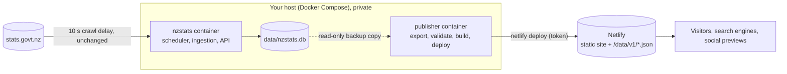

# Public website on Netlify

This publishes the dashboard as a static website. The Docker deployment (FastAPI, SQLite, scheduler) is unchanged and stays
private. The public site never calls it: it reads JSON snapshots exported from the database after verified ingestion.

Design and audit: [2026-10-24-netlify-static-publication.md](superpowers/specs/2026-10-24-netlify-static-publication.md).

**Nothing here deploys anything by itself.** The publisher container starts in dry-run mode and only publishes when
`PUBLISH_ENABLED=1` is set. Do not set it until you have completed the first-deployment checklist.

## How it fits together



| Piece | Where | Public? |
|---|---|---|
| Ingestion, SQLite, FastAPI, scheduler | your host | no |
| Snapshot export and validation (`nzstats export-snapshot`, `validate-snapshot`) | publisher container | no (it only writes public JSON) |
| Static site (React build, prerendered page metadata, `data/v1/*.json`) | Netlify | yes |

What is published: series values with their provisional/final status and `released_in`, release titles, publication and
reference dates, source URLs, bundle hashes, analysis text and caveats, and per-source last-checked/last-success times.
What is not: the database, the ingestion log (`ingest_run`), per-source error text, file paths, the contact address in
the User-Agent, any credential. The exporter fails if any of those appear.

## Manual export (do this first)

From the repository, with the backend installed (`pip install -e backend`):

```sh
export NZSTATS_DATA_DIR=/path/to/data            # the directory holding nzstats.db
nzstats export-snapshot ./snapshot               # exports, reconciles with the database, validates
nzstats validate-snapshot ./snapshot --for-publish
```

`export-snapshot` opens the database read-only (SQLite backup API into a temporary copy), so it is safe while the app
runs. It refuses to run if:

- the data directory carries the `FIXTURE_DATA` marker (written by any runtime built with an injected fetcher: tests,
  `scripts/seed_e2e_db.py`, fixture dumps);
- CPI, card transactions or the migration series are missing;
- any exported point differs from the database, any payload does not match the API's response model, or any file
  contains a path, e-mail address, credential word, stack trace or database name.

Then build the site and look at it before anything goes near Netlify:

```sh
scripts/build_static_site.sh --snapshot ./snapshot --site-url https://YOUR-SITE.netlify.app
python3 scripts/serve_static.py frontend/dist-static --port 4173     # applies netlify.toml's routes and headers
```

The build refuses a snapshot that is not production data, and finishes with `nzstats check-site`, which checks assets,
page metadata, the sitemap, `netlify.toml`, leaks and local addresses. The site URL is required because canonical URLs,
the sitemap, share links and PNG footers need it.

## First deployment

1. **Create the Netlify site without linking Git.** Netlify dashboard, Add new site, "Deploy manually" (or
   `netlify sites:create`). Do not connect the GitHub repository: it is private and has no data in it. (If it is ever
   linked, `netlify.toml`'s build command fails with an explanation rather than publishing an empty site.)
2. **Use a dedicated account or team** that owns only this site, and create a personal access token for it. Netlify
   tokens are not scoped to one site, so isolation comes from the account. Note the site's ID (Site configuration, Site
   information).
3. **Configure the publisher** on the host:
   ```sh
   cp .env.publisher.example .env.publisher && chmod 600 .env.publisher
   # set NETLIFY_AUTH_TOKEN, NETLIFY_SITE_ID, PUBLISH_SITE_URL (the https://….netlify.app address for now)
   mkdir -p publisher-state && sudo chown 10001:10001 publisher-state     # not needed on Docker Desktop
   docker compose -f docker-compose.publisher.yml build
   ```
4. **Dry run.** `docker compose -f docker-compose.publisher.yml run --rm publisher once` exports, validates and builds
   but deploys nothing (`PUBLISH_ENABLED=0`). Fix anything it reports.
5. **Draft deploy.** Set `PUBLISH_ENABLED=1` and `PUBLISH_DRAFT=1`, run `once` again. This uploads to a Netlify *draft*
   URL, not the public site. Check it (list below).
6. **Production deploy.** Set `PUBLISH_DRAFT=0`, run `once`, confirm the output ends `deployed: … deployed and confirmed
   live`, then `docker compose -f docker-compose.publisher.yml up -d` to keep checking.
7. **Custom domain (optional).** Add it in Netlify, then change `PUBLISH_SITE_URL` to it and republish with
   `--force`, because canonical URLs, the sitemap and share links are built from that address.

### Draft-deploy checklist

Open the draft URL and check:

- [ ] `/`, `/stories`, a story, `/inflation`, `/migration`, `/calendar` load; refresh each; a story opened in a new tab works.
- [ ] `/no-such-page` shows the not-found message with a 404 status (`curl -I`).
- [ ] `/data/v1/manifest.json` is JSON, with `"origin": "production"`; `/data/v1/nope.json` is a 404, not the app.
- [ ] Response headers on `/`: `content-security-policy`, `x-content-type-options`, `strict-transport-security`.
- [ ] `content-encoding: br` or `gzip` on `/data/v1/cpi.json` (the 2.6 MB of JSON is about 330 KB compressed).
- [ ] The footer strip shows "Data last updated …" and "not a live feed"; no red "Test data" banner.
- [ ] A story's PNG export downloads, and "Share link" copies the canonical address.
- [ ] Paste a story URL into a link preview tool (or Slack/LinkedIn) and confirm title, description and image.
- [ ] Browser console is clean; Network panel shows no request to another origin.
- [ ] `/robots.txt` allows crawling and names `/sitemap.xml`; the sitemap lists the pages.

## Automated refresh

The publisher container runs `nzstats publish-site` every `PUBLISH_INTERVAL_MINUTES` (default 60). Each run:

1. exports a snapshot and validates it with `--for-publish` (production origin only);
2. compares its content id with the last published one and with the live `manifest.json`; if they match, it stops;
3. deploys **immediately** if the verified data changed (`data_updated_at` moved), otherwise waits until
   `PUBLISH_MIN_INTERVAL_HOURS` (default 24) after the last deploy, so calendar-only changes cannot burn credits;
4. builds the site and deploys with the Netlify CLI (token passed in the environment, never on a command line);
5. fetches the live manifest and confirms it shows the new snapshot, reporting `deployed_unverified` if not.

A failure at any step before the deploy leaves the live site exactly as it was. Nothing in ingestion changes: the
publisher only reads the database, so a failed publish never affects data collection.

Typical cadence: ECT monthly, migration monthly, CPI quarterly, so roughly 6 to 12 data deploys a month.

Run once by hand: `docker compose -f docker-compose.publisher.yml run --rm publisher once`. Without Docker, the same
thing is `nzstats publish-site --work-dir ./publisher-state --site-url https://… [--dry-run|--draft|--force]` from a
checkout with Node 22 and `netlify-cli`, with `NETLIFY_AUTH_TOKEN` and `NETLIFY_SITE_ID` in the environment; schedule
it with cron or the Synology Task Scheduler.

Status and logs: `docker compose -f docker-compose.publisher.yml logs -f publisher`; state in
`publisher-state/state.json` (last snapshot id, deploy time, deploy id) and one manifest per deploy in
`publisher-state/history/`.

## Rollback

Netlify keeps every deploy; a rollback is instant and does not rebuild.

1. **Stop the publisher first** (`docker compose -f docker-compose.publisher.yml stop`), or it may redeploy the data
   you are rolling back.
2. Netlify dashboard, Deploys, pick the last good deploy, "Publish deploy". Or
   `netlify api listSiteDeploys --data '{"site_id":"…"}'`, then `netlify api restoreSiteDeploy --data '{"site_id":"…","deploy_id":"…"}'`.
3. Find out why (`publisher-state/history/` shows which snapshot each deploy carried).
4. Restart the publisher. It will not redeploy the same data (`last_snapshot_id` matches); it deploys again when the
   data next changes. To publish a corrected snapshot immediately, run `once` with `PUBLISH_MIN_INTERVAL_HOURS=0`
   or `nzstats publish-site --force`.

To take the site offline, use Netlify's "Stop auto publishing" and unpublish, or delete the site. The data is not lost:
the database is untouched.

## Cost

Netlify's pricing page at the time of writing lists the Free plan as 300 credits, with production deploys at 15 credits,
bandwidth at 20 credits per GB and web requests at 2 credits per 10,000. It did not state whether the 300 credits reset
monthly or what happens at the limit, and the Personal plan is $9/month for 1,000 credits. **Check the current pricing
and your plan's terms before relying on this.** The CLI deploy uses no build minutes.

| Item | Amount | Credits (Free-plan rates) |
|---|---|---|
| Data deploys | about 8 a month (range 6 to 12) | 90 to 180 |
| One visit to the home page | about 0.65 MB compressed (about 330 KB of data plus the app) | |
| 1,000 visits a month | about 0.65 GB | about 13 |
| 10,000 visits a month | about 6.5 GB | about 130 |

So the Free plan's 300 credits cover the publisher plus roughly 5,000 visits a month; busier than that needs a paid
plan or a lower deploy count. Levers: raise `PUBLISH_MIN_INTERVAL_HOURS`, publish only on release days, or trim the
2.6 MB of JSON (card transactions is two thirds of it). Mid-month deploys are only worth their cost when a release or
correction has landed.

## Remaining operational risks

- **The Netlify token can change or delete the site** and lives on the host in `.env.publisher` (mode 600). Use a
  dedicated account; rotate it if the host is ever exposed.
- **The publisher image is built in CI but never run against Netlify there.** Its logic is covered by tests with a fake
  Netlify CLI; the first real deploy (draft first) is the end-to-end test.
- **Mixed data on one page during a deploy.** The client checks every file against the manifest and retries once; if a
  deploy lands mid-visit the page may show an "unavailable, try again" state for a moment instead of mixed numbers.
- **Search and social previews** are metadata only; the page content itself is client-rendered. Per-story images are not
  generated (one site card is used).
- **Netlify is the authority on routing.** `scripts/serve_static.py` reproduces the documented rules and was checked
  against Netlify's own local server, but the draft deploy is the real test.
- **A stale site is possible** if the publisher stops (host down, token expired). The footer states when the data was
  last updated, so the site never claims to be current; watch the publisher logs, or set an external uptime check on
  `/data/v1/manifest.json` and alert when `generated_at` is old.
- **Provisional data is public.** It is labelled as in the app (provisional badges, caveats, `released_in`), and a
  correction replaces it on the next deploy.
- **The repository must stay private;** the publisher image copies the code but never the database or `.env` files
  (`.dockerignore`).
