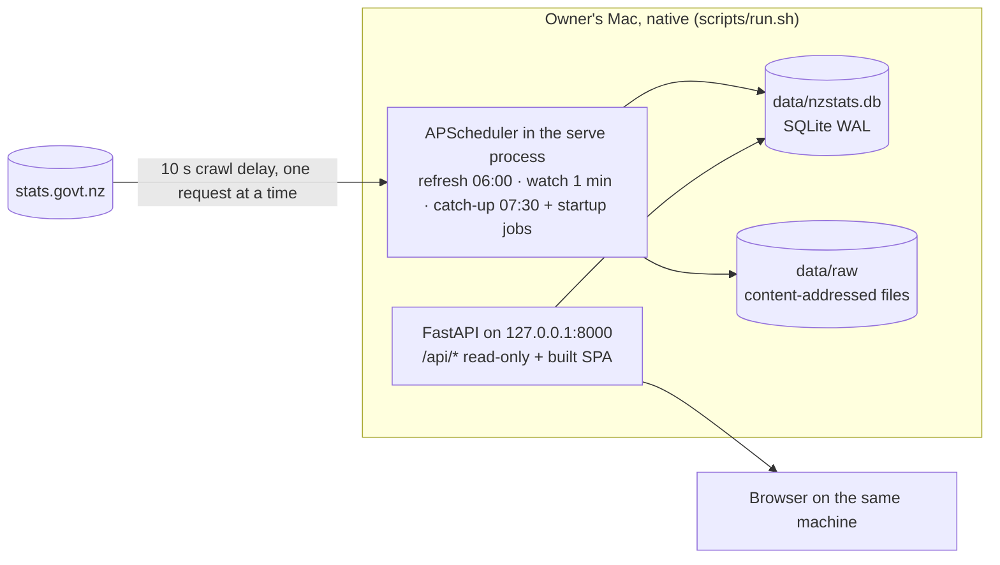

# Phase 4E: internal readiness (local operation only)

Assessment: 30 October 2026, Pacific/Auckland. **Internal operation: GO WITH CONDITIONS.**

This is a separate decision from the [Phase 4E public-release report](phase-4e-release.md), whose **NO-GO for public
deployment** stands unchanged as historical evidence. Nothing here approves Netlify, a public site or unattended
collection. Machine evidence: [internal-readiness/results.json](phase-4e-evidence/internal-readiness/results.json).

## Scope

In scope: running the dashboard on the owner's machine through the native Python/Node toolchain, with the API and UI on
loopback, the reconciled production database, and the scheduler available but not enabled for unattended use.

Excluded completely: Netlify, the publisher container and its dry runs, site IDs and canonical public URLs, static hosting,
draft uploads, production-domain publication and public rollback references. `scripts/e2e_static.sh` (the public static
build) was therefore not run.

No request was made to Stats NZ, RBNZ, Netlify or any research source. The Phase 4E backfill was not repeated. Production
`data/nzstats.db`, the `.request-pace` journal and all 43 raw files have identical SHA-256 before and after the assessment;
every runtime check used an isolated copy (SQLite online backup from a read-only connection, plus the raw tree).

## Code

| Item | Value |
|---|---|
| Assessed main | `efd4f1ac04dbb46c1e7b17d4cb8f892263d63988` (PR #24 merge) |
| Branch | `fix/phase-4e-internal-readiness`: one fix commit (`scripts/run.sh` + regression test) and this report |
| Production data | schema 10; 187 releases, 450 series, 791 vintages, 76,402 observations, 43 raw artifacts; research tables empty; last ingest 29 Oct 2026 20:57 NZDT |

## Internal architecture



`scripts/run.sh` is the supported native entry point: it installs the backend into `backend/.venv`, builds the UI on first
run and serves on `127.0.0.1` only. `scripts/run.sh --no-scheduler` serves without touching the network; plain
`scripts/run.sh` also starts the scheduler, which contacts Stats NZ. Docker is an alternative packaging of the same
process, not a dependency: the native path has every component the container has (API, UI, scheduler, migrations,
backup, verify-backup). **Docker is not required for internal operation**; its absence leaves only the container gate open.

## Results

### Local regression (all on this commit, this machine)

| Check | Result |
|---|---|
| Backend pytest, Python 3.12.13 (CI version) | 2,809 passed, 1 known Starlette/httpx deprecation warning |
| Backend pytest, Python 3.14.6 (`backend/.venv`) | 2,809 passed, same warning |
| New `tests/test_run_script.py` | 3 passed after the fix; the override test failed before it |
| Ruff check / format | pass (272 files) |
| Frontend unit (Vitest) | 478 passed in 47 files |
| Typecheck, lint, build | pass; known 3 Fast Refresh warnings and large ECharts chunk |
| API types regenerated | no diff |
| `npm audit --audit-level=low` | 0 vulnerabilities |
| Playwright live, fixture data | 150 passed (desktop, tablet, mobile) |
| Playwright research, synthetic loopback | 18 passed, 3 screenshot-only skips |
| Offline evidence replay (`reproduce_offline.py`, `reproduce_workbooks.py`, `reproduce_production.py`) | pass, no unexplained discrepancies (run in a scratch root so retained `data/phase-4e/` reports were not overwritten) |
| gitleaks over git history | 2 findings, both false positives: the word "token" beside `PUBLISH_ENABLED` in two planning tables |
| Not run | `scripts/e2e_static.sh` (excluded by scope); Python dependency audit (`pip-audit`/`safety` not installed, installing needs approval) |

### Native runtime

| Check | Result |
|---|---|
| `nzstats serve --no-scheduler` over the isolated copy | ready in under 1 s; bound to `127.0.0.1` only |
| API | `/api/health`, `overview`, `releases`, `calendar`, `series`, `cpi`, `ect`, `gdp`, `labour-market`, `migration/countries` all 200 (2–81 ms); unknown `/api` path is a JSON 404 |
| UI routes | served by the SPA; unknown routes render "That page does not exist" |
| SIGTERM | lifespan shutdown completes; `integrity_check` ok; counts unchanged |
| Restart | `scripts/run.sh --no-scheduler` over a restored backup serves the same values (below) |
| Scheduler natively | yes: the real `serve` with scheduler, run under an in-process network guard (native stand-in for Docker's `--network none`), registered `startup_refresh`, `release_watch`, `startup_catch_up`, `refresh_calendar`, `catch_up` |

### Scheduler and release monitoring

The native scheduler run refused 16 DNS lookups for `www.stats.govt.nz` before any packet left the host. Retries were
spaced exactly 10 s apart, the calendar sources became `degraded` with their last successes retained, the startup catch-up
waited for the runtime lock and found nothing due, and the minute watch skipped (not queued) while the lock was held.
After shutdown, observations, vintages, a value digest, release statuses and ingest runs were identical to the baseline.

Deterministic coverage (fake site serving real official fixtures, mocked clock and network) exists for each requirement:

| Requirement | Evidence |
|---|---|
| Calendar scheduling, upcoming detection | `scheduler/test_jobs.py::test_refresh_calendar_job_reports_result`, `test_new_publication_flows_from_calendar_to_dashboard`, `test_scheduler_registers_three_jobs_in_auckland_time`; `pipeline/test_discover*.py` |
| Publication-day ingestion | `test_watch_does_nothing_and_makes_no_requests_before_publication`, `test_watch_ingests_at_publication_time_then_goes_quiet`, `test_daylight_saving_publication_is_polled_at_the_right_instant`, `scheduler/test_cpi_release_day.py` |
| Catch-up after interruption | `test_catch_up_recovers_after_downtime`, `test_catch_up_after_downtime_ingests_the_missed_release`; native startup catch-up above |
| Missed / late releases | `test_watch_retries_when_files_appear_late`, `test_window_expires_and_marks_unavailable`, `test_unavailable_catch_up_retries_once_per_auckland_day`, `test_exhausted_release_with_a_non_404_failure_keeps_a_daily_retry` |
| Failed or incomplete downloads | `pipeline/test_ingest.py::test_page_live_but_data_file_missing_is_not_available_and_writes_no_vintage`, `test_missing_files_of_a_published_release_degrade_release_health` |
| Rate limits, retry, cooldown | `sources/test_fetcher*.py`; `test_a_block_page_pauses_polling_until_the_cooldown_ends`, `test_a_block_ends_the_batch_instead_of_spending_every_due_release`, `test_unavailable_daily_retry_keeps_blocked_cooldown_across_midnight`; `NZSTATS_MIN_INTERVAL_SECONDS` below 10 is refused at start |
| Transaction rollback, last-known-good | `test_validation_failure_writes_nothing_and_keeps_last_known_good`, `test_inconsistent_correction_is_rejected_and_keeps_the_last_good_vintage`, `test_layout_change_on_release_day_fails_safely_and_is_visible`; real SIGKILL test below |
| Staleness and freshness | `pipeline/test_ingest.py` health tests; `api` tests; UI "Data last updated … not a live feed" stamp and Data health page (real-data pass below) |

### Recovery

| Check | Result |
|---|---|
| Interrupted ingestion | A real process was SIGKILLed inside the write transaction after observations were inserted. Afterwards: `integrity_check` ok, no foreign-key violations, no orphan observations, earlier release unchanged (249 vintages), killed release absent. A plain retry ingested it (244 vintages). |
| Backup | `scripts/run.sh backup <dest>` wrote and verified a schema-10 backup |
| Restore | backup plus raw tree restored into a new directory; `verify-backup --live --raw-dir` ok (78,704 rows in 26 tables); the restored app passed the full API-to-SQL check |
| Damaged backup / missing raw | `verify-backup` exits 1 for a corrupted page range and for 43 missing raw files |
| Research and OCR | all ten research sources: LLM `denied`, display `none`; RBNZ access `restricted`; `research summarise` without a provider exits 1; public research unset so `/api/research/*` is 404; OCR page reads "Not shown yet" |

### Statistical integrity

The three Phase 4E replay scripts pass against an isolated copy. Independently of them:

- **API to SQL:** every one of 450 series returns the latest SQL vintage (newest publication, then capture) with identical
  points: 37,460 points, zero differences. `/api/gdp` (1,857 points), `/api/labour-market` (1,624) and CPI index points
  (5,577) also equal SQL. Latest reference periods: GDP and labour 2026-06, CPI 2026-09.
- **Identities recomputed from API values (June 2026 quarter):** GDP production SA quarterly 0.2%, annual 2.6% and NSA
  annual-average 1.7% all reproduce; HLFS employed 2,905 + unemployed 171 = labour force 3,076; unemployment 5.6%,
  participation 70.7%, employment 66.7% reproduce; LCI 0.6% quarterly, 2.0% annual reproduce.
- **GDP measure definitions** are separate series by approach (production/expenditure), price basis (chain volume/current
  prices), adjustment and measure (level, quarterly, annual, annual-average change); per-capita series are distinct.
- **Vintage attribution:** all 16 GDP and 8 labour revision rows carry `first_is_publication: false`, so the backfilled
  baselines are shown as earliest stored, never first published (GDP March 0.8 → 0.9, unemployment 5.3 → 5.4). CPI
  revisions state 4 stored vintages, earliest December 2025, and that earlier revisions cannot be observed.
- **Forecast-to-actual matching:** no production forecasts exist, so this rests on `research/test_outcomes*.py`,
  `test_evaluate.py`, `test_compare.py`, `insights/test_macro_overview.py`, which pass.
- **Attribution and reporting periods:** every series `source_url` is `https://www.stats.govt.nz/`; every rendered page
  names Stats NZ; the GDP, labour and CPI payloads carry `reference_period`, `published_at` and `captured_at`, and per-series
  responses carry the vintage's release key, publication and capture times.

### Performance and UX (real data, restored copy, served by `scripts/run.sh`)

48 views (12 routes × 1440×900 / 390×844 × light/dark): no page errors, no external requests, no horizontal overflow, no
stuck loading state; dark mode follows `prefers-color-scheme`. Load to network idle: median 906 ms, maximum 1,057 ms
(excluding the not-found probe, whose 10.5 s is the harness's heading timeout on a page with no `h1`). All
18 CSV and 18 PNG exports on the five data pages downloaded; every PNG is a valid image. GDP, labour, CPI, migration and
ECT pages render charts and the freshness stamp. Loading/error/empty states are covered by the Vitest and Playwright
suites above; the outlook page's empty research state renders correctly.

## Defects and findings

| # | Severity | Finding | Status |
|---|---|---|---|
| 1 | Medium | `scripts/run.sh` sourced `.env` after the caller's environment, so `NZSTATS_DATA_DIR=/copy scripts/run.sh` silently used production `./data` (and without `--no-scheduler` would start network jobs on it). Reproduced with a stubbed checkout. | **Fixed on this branch** with regression tests; needs review and merge |
| 2 | Medium (operational) | No time-based staleness: if the scheduler stops or hangs, sources stay `ok` with ageing timestamps; `/api/health` has no scheduler heartbeat. Failure states (`degraded`, error classes, recent runs) are visible, but nothing alerts. | Condition 3 |
| 3 | Low | `scripts/backup.sh` works only through Docker and omits `data/raw`; natively use `scripts/run.sh backup` plus a raw-tree copy | Condition 4 |
| 4 | Low | Four migration chart CSVs lack `release_key`/`source_url` columns (GDP, labour and CPI exports have them); values are correct | Not fixed: adding columns is a feature change |
| 5 | Low | `/economic-outlook` logs five network 404s for the deliberately unmounted `/api/research/*`; no JavaScript error, the page shows its empty state | Not fixed: cosmetic |
| 6 | Info | `nzstats serve` defaults to `0.0.0.0` (container default) and the Playwright web server uses it on fixture data; `scripts/run.sh` forces loopback | Use `run.sh` |

No critical or high-severity defect is unresolved.

## External infrastructure limitations

| Gap | Evidence | Owner action |
|---|---|---|
| Hosted GitHub Actions | [Run 40842640174](https://github.com/kcha193/NZ-Stats-Intelligence-Dashboard/actions/runs/40842640174) on `efd4f1a`, attempt 2 (2026-10-29T19:39:48Z): backend, frontend, static-site failed with 0 steps, docker skipped. Annotation: "The job was not started because recent account payments have failed or your spending limit needs to be increased." Not rerun again. | GitHub → Settings → Billing & plans: fix the failed payment or raise the Actions spending limit, then rerun once |
| Docker runtime | CLI only; no daemon, Docker Desktop, OrbStack, Colima or Podman | Only needed for container operation; install requires approval |
| Real alert delivery | No alert channel exists; only alert *logic* (health states) was tested | Choose a destination if unattended operation is approved |

## Decision

**GO WITH CONDITIONS for local/internal operation.** The app starts and runs correctly through the supported native
architecture; the verified official data is retained byte-for-byte; API and dashboard values equal SQL; scheduler and
ingestion behaviour is validated deterministically and by a network-guarded native run; backup, restore and an
interrupted ingest recover; validation fails safely; research, LLM and OCR acquisition remain disabled.

Conditions:

1. **Merge the `run.sh` fix** (this branch) before using `NZSTATS_DATA_DIR` overrides with `scripts/run.sh`. Until then
   call `backend/.venv/bin/nzstats` directly for isolated copies.
2. **Interactive use only until routine collection is approved.** Use `scripts/run.sh --no-scheduler`. Starting the
   scheduler contacts Stats NZ, and the Phase 4E approval covered seven releases only. Enabling it, and any launchd/cron
   supervision, needs explicit owner approval.
3. **Manual monitoring while running the scheduler:** check the Data health page or `/api/health` daily. Investigate any
   `degraded` source, any non-`ingested` recent run, or a `calendar_refresh` `last_checked_at` older than about 26 hours
   (the stalled-scheduler signal). Watch the first native release, labour market **4 November 2026 10:45 NZDT**, whose
   unseen layout must fail closed.
4. **Native backups:** `scripts/run.sh backup data/backups/nzstats-$(date +%F).db` plus a copy of `data/raw`, then
   `verify-backup --raw-dir`. A laptop that sleeps through a release is recovered by the startup and 07:30 catch-up
   within 7 days.

Technical gaps that remain open and are not claimed as passed: hosted CI, the Docker build/smoke gate, real alert delivery,
a live release under the native scheduler, and a Python dependency audit.

## Reproduce

From the repository root, against an isolated copy (never `data/`):

```sh
mkdir -p /tmp/iso /tmp/iso2
python3 -c 'import sqlite3; s=sqlite3.connect("file:data/nzstats.db?mode=ro", uri=True); d=sqlite3.connect("/tmp/iso/nzstats.db"); s.backup(d)'
cp -R data/raw /tmp/iso/raw
NZSTATS_DATA_DIR=/tmp/iso backend/.venv/bin/nzstats verify-backup /tmp/iso/nzstats.db --live data/nzstats.db --raw-dir /tmp/iso/raw
NZSTATS_DATA_DIR=/tmp/iso scripts/run.sh --no-scheduler --port 18082 &
backend/.venv/bin/python -I docs/phase-4e-evidence/internal-readiness/api_db_check.py /tmp/iso/nzstats.db http://127.0.0.1:18082
node docs/phase-4e-evidence/internal-readiness/ux_pass.mjs "$PWD/frontend" http://127.0.0.1:18082 /tmp/ux
(cd backend && PYTHONPATH=. .venv/bin/python ../docs/phase-4e-evidence/internal-readiness/kill_ingest.py "$(mktemp -d)")
# Scheduler with all non-loopback networking refused in-process (use a second copy; it writes health rows):
NZSTATS_DATA_DIR=/tmp/iso2 backend/.venv/bin/python docs/phase-4e-evidence/internal-readiness/native_scheduler.py 18081
```
