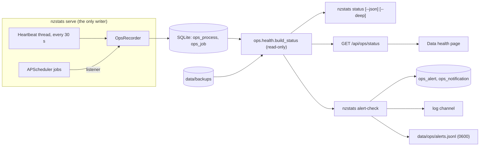

# Phase 4F: operational health specification

Status: implemented on `feat/phase-4f-native-monitoring`. Scope: the dashboard run natively on one machine
(`scripts/run.sh`). Netlify, Docker deployment, public publishing and any unattended collection are out of scope and
unchanged. Operating procedures are in [phase-4f-runbook.md](phase-4f-runbook.md); evidence is in
[phase-4f-evidence/](phase-4f-evidence/).

## What problem this solves

Phase 4E found that nothing noticed a stopped or hung scheduler: sources stayed `ok` with ageing timestamps, and there was
no way to tell "collection is off on purpose" from "collection should be running and is not". This phase makes the
dashboard able to say, from local data alone and without contacting any network:

1. Is data collection meant to be running, and is it?
2. Is the application working, and was the last stop clean?
3. Is the data current, meaning has every release the calendar says is published been ingested?
4. When is the next official release?
5. Is there a recent, verifiable backup?
6. What should the operator do?

## Architecture



- **Writer.** `nzstats serve` registers a process row at start, updates its heartbeat every 30 s, records each scheduler
  job's start, finish, outcome and (class only) error, and stamps a clean stop on shutdown. `SIGHUP` (closing the
  terminal) is turned into the same graceful shutdown as `SIGTERM`, unless the process was started under `nohup`.
- **Readers.** `status`, the API and `alert-check` all call one function, `ops.health.build_status`. It only reads.
  `status` opens the database with `mode=ro`, so it cannot create, migrate or modify anything, and works beside a running
  dashboard or on a database that is behind the code (it reports that; it does not migrate).
- **No network.** Nothing in `nzstats.ops` imports an HTTP client. `status` never builds a runtime, fetcher or scheduler.
  Tests install a guard that fails on any non-loopback lookup or connection.
- **Storage.** Migration `011_operations.sql` adds `ops_process`, `ops_job`, `ops_alert`, `ops_notification`. None is
  exported to a public snapshot. Only the exception class of a failed job is stored, never its message.

## Deliberately disabled versus stalled

The recorder stores whether the scheduler was enabled with each process. The reader combines that with liveness:

| Process state | Meaning | How it is decided |
|---|---|---|
| `running` | Reporting normally | Unstopped row, heartbeat within `heartbeat_stale_seconds`, process id exists |
| `stalled` | Alive but silent (hung) | Heartbeat stale and the process id still exists. ATTENTION, CRITICAL beyond `heartbeat_critical_seconds` |
| `lost` | Gone without a clean stop (kill, crash, power) | Process id gone with no clean-stop record, even if the last heartbeat was seconds ago |
| `stopped` | Shut down cleanly | `stop_reason = clean` |
| `never_started` | No record | No `ops_process` rows (a new or pre-upgrade database) |

| Collection mode | Meaning | Shown when |
|---|---|---|
| `enabled` | The scheduler is meant to be checking Stats NZ by itself | Process `running`/`stalled` and started with the scheduler |
| `disabled` | Off by choice (`--no-scheduler`) | Process `running`/`stalled` and started without it. **Not a fault** |
| `paused` | The dashboard is not running, so nothing is collected | Process `stopped`/`lost` |
| `unknown` | Never recorded | `never_started` |

Scheduler-specific problems (`scheduler:no_progress`, missed calendar refreshes, long-running jobs) are evaluated **only**
in `enabled` mode with a `running` process. When collection is `disabled` or `paused`, the same dashboard is instead held
to the manual standards below: releases that came due and were not ingested, and a calendar older than
`calendar_manual_attention_days`.

## Data currency, and why old observations are not missed releases

A series whose newest reference period is old is **current** when Stats NZ has not published since. A release is
**overdue** only when the calendar lists it, its publication time plus the grace period has passed, it has no vintage, and
it is newer than the newest release already ingested for that series. Releases older than the newest ingested one are
history gaps for `backfill`, not staleness. The Data health table therefore shows, per supported release series, the
newest reference period, its publication time, `Current` / `Overdue: <key>` / `No data yet`, and the next scheduled release.

## Time handling

- Storage is UTC ISO-8601; every displayed time is Pacific/Auckland with an explicit offset (`+13:00` / `+12:00`) or
  abbreviation (`NZDT` / `NZST`).
- The daily 06:00 refresh and 07:30 catch-up times are one constant in `scheduler/jobs.py`, read by both the scheduler
  and `ops.schedule`, so they cannot disagree. A "missed refresh" is counted against Auckland **calendar dates**
  (`last_refresh_due`, `missed_refreshes`), never as "24 hours after the last run": the day is 23 h long on 27 Sep 2026
  and 25 h long on 4 Apr 2027. Tests cover both boundaries, including a refresh that is missed after only 25 elapsed hours.
- **Laptop sleep.** The heartbeat compares the wall clock with `time.monotonic()`, which does not advance while the host
  sleeps. A large difference is recorded as a *suspend* (count, time, length), not a stall. For
  `resume_grace_seconds` after waking, an apparently idle scheduler is not reported. APScheduler's one-hour misfire grace
  still drops a 06:00 refresh slept through; that surfaces as `calendar:missed` with a clear action. The scheduler is
  **not** changed to fetch on wake: it would be a new automatic request pattern, which needs the owner's approval.

## Checks, keys, severities and actions

Every issue has a stable key (the de-duplication identity), a severity, a title, facts, and an action. Issue text is built
from keys, counts, times and error classes only, never from upstream response text.

| Key | Condition | Severity | Action |
|---|---|---|---|
| `database:unreadable` | Missing, not SQLite, or unreadable | CRITICAL | Check `NZSTATS_DATA_DIR`; restore a verified backup into a **new** directory |
| `database:integrity` | `status --deep`: `quick_check` fails | CRITICAL | Stop; restore into a new directory; keep the damaged file |
| `database:schema_behind` | Schema older than the code | ATTENTION | `scripts/run.sh migrate`, or start the dashboard |
| `process:stalled` | Alive, heartbeat stale | ATTENTION / CRITICAL | Check the terminal; stop and start it; catch-up recovers |
| `process:lost` | Gone without a clean stop | ATTENTION | Start it again; look for a crash |
| `process:unexpected_restart:<boot>` | A start found its predecessor dead, within 24 h | ATTENTION | Nothing if you expected it (reboot, power) |
| `scheduler:no_progress` | Enabled and running, but `release_watch` has not finished for 5 / 15 min | ATTENTION / CRITICAL | Restart; read the terminal for `release_watch` errors |
| `scheduler:job_running_long:<job>` | One run longer than 20 / 60 min | ATTENTION / CRITICAL | Watch the terminal; restart if hung (ingestion rolls back) |
| `scheduler:job_failing:<job>` | Unhandled exception; 3 in a row | ATTENTION / CRITICAL | Read the traceback in the log |
| `calendar:missed` | Enabled and running; 06:00 refreshes with no complete refresh after them (3 = CRITICAL) | ATTENTION / CRITICAL | Restart (startup refresh) or `scripts/run.sh discover` |
| `calendar:stale` | Collection off or stopped; last refresh older than 7 days | ATTENTION | `scripts/run.sh discover` |
| `calendar:never` | No complete refresh ever (after startup grace) | ATTENTION | `scripts/run.sh discover` |
| `release:overdue:<key>` | Due, past grace, no data, newer than newest ingested (7 days = CRITICAL) | ATTENTION / CRITICAL | Depends on mode and last error class; rejected files need review, not retries |
| `freshness:no_data` | A supported series has no vintage | ATTENTION | `discover` then `backfill` |
| `source:degraded:<source>` | Source health not `ok` (calendar source silent 3 days = CRITICAL; suppressed when its release is already `release:overdue`) | ATTENTION / CRITICAL | Read the error class in Data health |
| `source:blocked` | Block page seen in the last 24 h | ATTENTION | Do nothing; polling pauses 30 min; never retry in a loop |
| `backup:none` | No backup found | ATTENTION | Take a bundle |
| `backup:stale` | Newest usable backup 7 / 30 days old | ATTENTION / CRITICAL | Take a bundle |
| `backup:failed` | Newest backup incomplete or failed verification | ATTENTION | Keep it for inspection; take a fresh bundle |

Overall state is the worst issue. `alert_delivery` is reported beside it and never changes it.

## Thresholds

<!-- thresholds:start -->
| Setting | Default | Meaning |
|---|---|---|
| `heartbeat_interval_seconds` | 30 | How often the serve process records a heartbeat. |
| `heartbeat_stale_seconds` | 300 | No heartbeat for this long: the process is `stalled` (alive) or `lost` (gone). ATTENTION. |
| `heartbeat_critical_seconds` | 900 | A live process silent this long is CRITICAL. |
| `suspend_notice_seconds` | 150 | Wall clock ahead of the monotonic clock by more than this = the host slept (recorded, not a fault). |
| `resume_grace_seconds` | 600 | After waking, the scheduler is not called stuck for this long. |
| `startup_grace_seconds` | 180 | A new process has this long before its first calendar refresh is expected. |
| `watch_attention_seconds` | 300 | The one-minute release watch has not finished for this long (scheduler enabled and running). ATTENTION. |
| `watch_critical_seconds` | 900 | Same, CRITICAL. |
| `job_running_attention_seconds` | 1200 | One job invocation running this long (stuck or very large ingest). ATTENTION. |
| `job_running_critical_seconds` | 3600 | Same, CRITICAL. |
| `job_failures_critical` | 3 | Consecutive escaped exceptions of one job that make it CRITICAL (1 or more is ATTENTION). |
| `calendar_grace_minutes` | 120 | A 06:00 Auckland refresh is missed if no complete refresh follows within this many minutes. |
| `calendar_missed_critical` | 3 | Missed refreshes at which the calendar issue becomes CRITICAL. |
| `calendar_manual_attention_days` | 7 | With collection off or the dashboard stopped: last complete refresh older than this is ATTENTION. |
| `release_grace_floor_minutes` | 240 | A release is overdue this long after its publication time (never less than the last polling offset plus 60 min). |
| `release_critical_days` | 7 | An overdue release older than this is CRITICAL (the automatic catch-up window is 7 days). |
| `source_critical_days` | 3 | A degraded calendar source with no success for this long is CRITICAL. |
| `blocked_window_hours` | 24 | Block pages seen within this window raise `source:blocked`. |
| `restart_attention_hours` | 24 | An unexpected restart is reported for this long, then only noted. |
| `backup_attention_days` | 7 | Newest usable backup older than this is ATTENTION. |
| `backup_critical_days` | 30 | Same, CRITICAL. |
| `delivery_window_hours` | 24 | Window for counting alert delivery failures. |
<!-- thresholds:end -->

A test fails if this table and `ops/thresholds.py` disagree.

## Commands and exit codes

| Command | Writes? | Network? | Exit |
|---|---|---|---|
| `nzstats status [--json] [--deep] [--backup-dir D]` | No (`mode=ro`) | No | 0 OK, 1 ATTENTION, 2 CRITICAL, 3 could not be computed |
| `nzstats alert-check [--channels log,file]` | `ops_alert`, `ops_notification`, `data/ops/alerts.jsonl` | No (local channels only) | Same as `status` (the application's state). Delivery problems go to stderr and the delivery log, never into the code |
| `nzstats backup --bundle DEST` | New directory `DEST` only | No | 0 / 1 |
| `nzstats verify-backup PATH` | No | No | 0 / 1 (`PATH` a directory = bundle) |
| `nzstats restore-backup SRC DEST` | New directory `DEST` only | No | 0 / 1 |
| `GET /api/ops/status`, `GET /api/capabilities` | No | No | HTTP |

## Alerting

`ops.alerts` is independent of any channel. A channel implements `name` and `send(Notification)`. Shipped: `log` (the
`nzstats.alerts` logger) and `file` (JSON lines, directory `0700`, file `0600`).

- **Open** an alert when an issue key first appears; **escalate** immediately ATTENTION to CRITICAL; **remind** after 12 h
  (CRITICAL) or 72 h (ATTENTION) while it stays open; **resolve** once, only if it was ever delivered.
- A repeated failure is not repeated. A delivery that no channel accepted is retried on the next check and does not count
  as delivered.
- At most 6 deliveries per hour; the rest are recorded `rate_limited` and retried. More than 3 changes in one check become
  one digest.
- Every attempt is a row in `ops_notification` (`sent`, `failed` with the exception class, `rate_limited`). A failing
  channel shows as `alert_delivery.state = failing` and is **not** an application fault.
- **Payload** is an allow-list: event, time, overall state, and per alert the key, severity, title, detail, action and first
  seen. Text is stripped of control characters and truncated. It is built from structured fields; upstream error text,
  exception messages, URLs and settings never enter it (tests plant secrets in all of them).
- **Future channels** (Telegram, email, webhook): implement `Notifier`, register it in `NOTIFIER_FACTORIES`, read any
  credential from an environment variable at send time (never the database, report or log). None exists, none is
  configured, and nothing is transmitted without the owner's approval.

## Native backup

`nzstats backup DEST` is unchanged (database only). `nzstats backup --bundle DEST` writes a directory:

```
DEST/MANIFEST.json   format, created_at (UTC), database + every raw file with size and SHA-256, verification record
DEST/nzstats.db      SQLite online backup
DEST/raw/ab/<sha256> every raw artifact the database references (content-addressed, so the name is the hash)
```

- **Atomic.** Built in a hidden sibling directory and renamed last. A crash leaves no directory that looks complete.
- **Complete or nothing.** A referenced artifact that is missing, outside the store, a symlink, or whose bytes do not
  match its name aborts the backup; nothing is written. An existing destination is never overwritten.
- **Verified.** `verify-backup DIR` re-hashes every file, rejects unlisted files and unexpected entries, then runs the
  existing restore validation (integrity, foreign keys, schema objects, raw files present) over the copied database. A
  bundle from an older schema is valid and reports `needs migrate`.
- **Restore** (`restore-backup`) verifies first, refuses a non-empty destination, and never writes to the bundle.
- The health check reads only the manifest and file sizes (cheap); `verify-backup` is the deep check. Plain `.db` files and
  earlier manual backup directories holding `nzstats.db` are counted as database-only, "unverified".

## Verification map

| Guarantee | Test |
|---|---|
| Healthy, disabled, stalled, lost, stopped, never started | `tests/ops/test_health.py` |
| Stalled-but-alive is not "disabled"; dead process with a fresh heartbeat is `lost` at once | `test_a_live_process_with_a_silent_heartbeat...`, `test_a_fresh_heartbeat_from_a_process_that_no_longer_exists...` |
| Stale and missed calendar refreshes | `test_missed_refreshes_escalate_with_the_count`, `test_a_failed_refresh_that_never_completed_a_batch...` |
| DST boundaries (spring forward, fall back) | `tests/ops/test_schedule.py`, `test_a_missed_refresh_across_the_spring_forward_day` |
| Process restart; laptop sleep | `tests/ops/test_recorder.py`, `tests/ops/test_serve.py` (real SIGKILL, SIGHUP, SIGTERM), `test_a_laptop_that_has_just_woken...` |
| Old observations are not missed releases | `test_old_observations_are_not_a_missed_release` |
| Alert de-duplication, escalation, rate limit, digest, delivery failure, payload hygiene | `tests/ops/test_alerts.py` |
| Backup: missing raw artifact, corrupted, incomplete, atomic, restore | `tests/store/test_backup_bundle.py` |
| No network | autouse guard in `tests/ops/conftest.py`; `native_monitoring_pass.py` counts refusals |
| No mutation | `test_status_changes_nothing_on_disk_even_beside_a_live_writer`; production fingerprint in `native_monitoring_pass.py` |
| Environment precedence (`NZSTATS_*`, `STATSNZ_*`) | `tests/test_run_script.py` |

## Known limitations

- Process liveness uses the operating-system process id on the same machine. A reused id could make a dead process look
  alive until its heartbeat goes stale (5 minutes). It is not meant for a database on a network share.
- `serve` is the only recorder. CLI `ingest`, `backfill` and `discover` are not tracked as jobs; their results appear
  through `ingest_run` and source health.
- `status` is a snapshot. Without something running `alert-check` periodically, a problem is found only when someone looks.
  Scheduling it (launchd or cron) is an owner decision, listed below.
- A 06:00 refresh slept through is reported, not repaired (see Time handling).
- The thresholds are conservative defaults, not tuned on real operating history.
- **Wake-up false alarm.** A `status` or `alert-check` run in the roughly 30 seconds between waking and the next heartbeat
  can see a stale heartbeat from a live process and report `process:stalled` (CRITICAL after 15 minutes of sleep). It
  resolves itself on the next beat; there is no hysteresis yet.
- **Daily refresh and sleep.** If the laptop is asleep at 06:00 every day and wakes after 07:00 with the process still running,
  APScheduler's one-hour misfire grace drops the refresh each day, and after three days `calendar:missed` is CRITICAL.
  That is an accurate report, not a monitoring error. Letting the refresh run on wake (a larger `misfire_grace_time`) is a
  scheduler behaviour change that would send requests at a new time, so it needs the owner's approval; it was not made.
- **Process id reuse** can make a process that died in a power cut look alive until its heartbeat goes stale (5 minutes),
  and then `stalled` instead of `lost` until the id is free again.
- **`/api/ops/status` is unauthenticated**, so `serve` registers it only when bound to loopback (`scripts/run.sh` always is);
  a non-loopback bind answers 404 unless `NZSTATS_OPS_STATUS=1`. When enabled it exposes the process id, sleep pattern,
  backup folder names and release error classes to whatever can reach the port; there is no Host-header check, so keep it
  on loopback. `/api/capabilities` only says whether public research is on.
- `alert-check` runs `migrate` (idempotent DDL) before recording alert state, like other write commands. `alert-check` with an
  unreadable database sends the current issues with no de-duplication, on purpose.
- Backup raw files are hash-verified but not fsynced before the final rename, so a power loss during `backup --bundle` is
  caught by `verify-backup`, not prevented.

## External approvals still required

Nothing below was done, configured or contacted.

1. **Scheduled collection.** Starting `scripts/run.sh` without `--no-scheduler` contacts Stats NZ. Phase 4E approval covered
   seven releases only.
2. **Hosted CI.** GitHub Actions jobs do not start: "recent account payments have failed or your spending limit needs to
   be increased". Fix billing, then rerun once.
3. **Periodic alerting.** A launchd/cron job running `alert-check` creates an unattended process.
4. **Any remote alert channel** (Telegram, email, webhook): choice of provider, credential storage, and permission to send.
5. **Docker image and smoke gate.** Needs a container runtime; not required for native operation.
6. **Python dependency audit.** `pip-audit` is not installed; installing needs approval.
