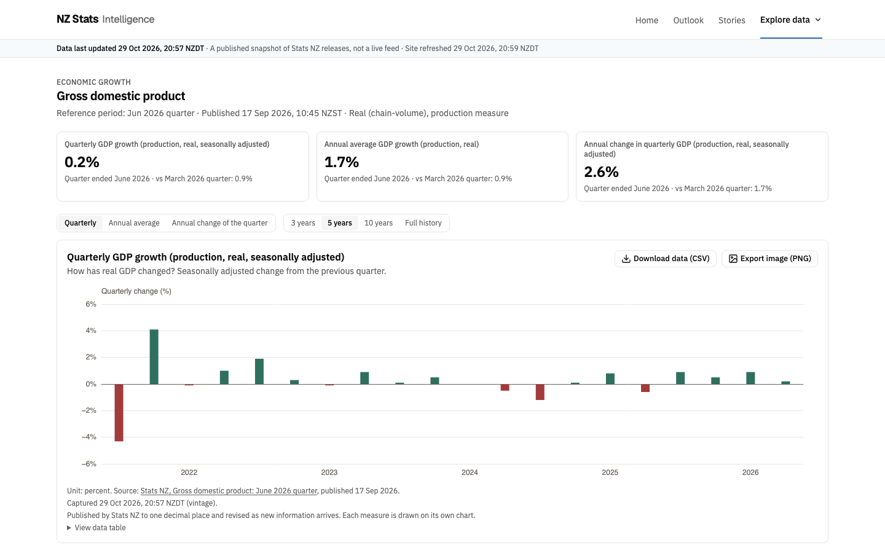

# Phase 4E production-data screenshots

Captured 29 October 2026 from the local Netlify-rules emulator, after the approved seven-release backfill. These use actual production observations, not fixture or institutional research data. They do not depict a Netlify deployment.

Snapshot: `75b42648f75c34e0635ff8a6fa8d6a61e0b12a84abe67c2920cef07823578d66`.
Code: `3ac92addea52908d926a93e4015c217cf6cde125`.
Canonical origin is the reserved rehearsal placeholder `https://nzstats-release.example`, not an owner-confirmed target. Desktop is 1440×900; mobile is 390×844. Light mode, reduced motion, fonts loaded. All six route/viewport checks passed with no horizontal overflow or page errors, and CSV/PNG exports passed at both sizes. Hashes are in [the machine record](../../phase-4e-evidence/screenshots.json).

The GDP desktop and labour mobile full-page images were visually inspected. KPI values, reference/publication/capture dates, separate measures, earliest-stored caveats, official source attribution and freshness labels are visible. Automated browser checks cover all six images; this is not physical-device, screen-reader or accessibility certification.

| Page | Desktop | Mobile |
|---|---|---|
| GDP | [Full page](gdp-desktop.png) · [Viewport](gdp-desktop-viewport.png) | [Full page](gdp-mobile.png) |
| Labour market | [Full page](labour-market-desktop.png) | [Full page](labour-market-mobile.png) |
| Inflation | [Full page](inflation-desktop.png) | [Full page](inflation-mobile.png) |

