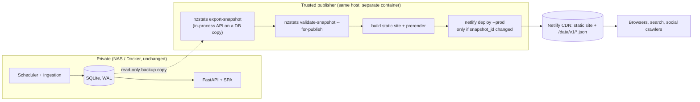

# Public static publication on Netlify: audit and design

Status: implemented on `feat/netlify-static-publication`. Public deployment is **not** enabled by this change.

## Goal and constraints

Publish the dashboard as a public website on Netlify while the FastAPI app, SQLite database, scheduler and Docker
deployment stay private and unchanged. The public site is a static React build that reads validated JSON snapshots
exported from the production database.

Hard constraints (from the brief and `CLAUDE.md`): no change to statistical calculations; no production database or
log in any public artifact; fixtures are never published as releases; the GitHub repository stays private; the 10 s
Stats NZ crawl delay is untouched; the Docker image keeps working; nothing deploys without approval.

## Phase 1 audit

### Frontend build and deployment

- Vite 8, React 19, React Router 7 (`BrowserRouter`), TanStack Query. `npm run build` = `tsc -b && vite build` to
  `frontend/dist`. Node 20. No SSR. `index.html` had the placeholder title `frontend` and no description or social
  metadata. The only public assets were `favicon.svg` and the bundles.
- FastAPI serves `dist` with an SPA fallback (`SPAStaticFiles`). Static hosting needs the equivalent rewrite.

### API endpoints the frontend calls (`src/api/hooks.ts`)

| Hook | Endpoint | Parameters actually used | Static representation |
|---|---|---|---|
| `useOverview` | `/api/overview` | none | `overview.json` |
| `useCpi` | `/api/cpi` | none | `cpi.json` |
| `useEct` | `/api/ect` | none | `ect.json` |
| `useHealth` | `/api/health` | none | `health.json` (sanitised) |
| `useReleases` | `/api/releases` | `limit` (200, 20), `category`, `status`, `offset` | `releases.json` (all, newest first), filtered in the adapter |
| `useRelease` | `/api/releases/{id}` | numeric id | `releases/{id}.json` |
| `useCalendar` | `/api/calendar` | `from`, `to` (month grid) or none (list) | `releases.json` windowed in the adapter plus `calendar.json` (freshness) |
| `useSeries` | `/api/series/{key}` | `mig.*` keys, latest vintage only | `series/{key}.json` |
| `useRevisions` | `/api/revisions/{key}` | `mig.m.net`, default base/compare | `revisions/{key}.json` |
| `useCountries` | `/api/migration/countries` | `months=12&top=15` | `migration/countries.json` |

Not used by the frontend, so not published: `/api/series` (list), `/api/series/{key}/csv` (CSV is built client-side by
`toCsv`), non-default vintages and revision comparisons, other country windows. The adapter raises a typed
"not published" error for those instead of guessing.

### Routing, story URLs, filters, exports

- Routes: `/`, `/stories`, `/stories/:id`, `/migration`, `/inflation`, `/electronic-card-transactions`, `/releases/:id`,
  `/calendar`, `/health`. Filters live in the query string (`category`, `importance`, `status`, `view`, `month`).
- Story ids are `<template>-<period>` and are derived from data, not stored. An id for an older period renders a
  "superseded" notice. Story pages therefore only exist for ids the current snapshot produces.
- Exports are client-side: CSV via `toCsv`, PNG via off-screen ECharts. The share link and the PNG footer use
  `window.location.origin`, which is wrong on deploy previews and the `*.netlify.app` alias.
- Charts, tooltips and CSV already escape upstream text (`escapeHtml`, `toCsv`).

### Data freshness and validation today

The backend validates and commits atomically per release; the API only serves committed, validated data. Last-known
good data survives failed updates. `overview.data_updated_at`, per-release `published_at`, per-vintage `captured_at`,
observation `status` (`provisional`/`final`/`unknown`) and `released_in` carry provenance and revision semantics.
`/api/health` exposes `ingest_run` rows (error class and detail) and `source_health.detail`: operational logs that must
not go public.

### Netlify compatibility gaps found

1. Calls `/api/*`, which does not exist on Netlify.
2. No SPA rewrite, no headers, no `netlify.toml`.
3. A catch-all rewrite would answer a missing `/data/*.json` with `index.html` and status 200; the client must not
   mistake that for data.
4. Share links and exports use `location.origin`.
5. No titles, descriptions, canonical URLs, Open Graph tags, sitemap or robots.txt.
6. The health page shows database state and the ingestion log; "monitor", refresh intervals and the absence of any
   snapshot timestamp would read as live data on a snapshot.
7. Story metadata is invisible to social crawlers, which do not run JavaScript.

## Design

### Decisions

1. **Exporter drives the real API, in process.** It copies the database with the SQLite backup API, builds the
   existing FastAPI app over the copy with a fixed clock and fetches the endpoints through a test client. Every number
   is produced by the unchanged production code and response models, so there is no second implementation of any
   statistic to drift. A reconciliation pass re-reads the copy and compares every published point to the database.
2. **Envelope per file**: `{schema_version, kind, snapshot_id, payload}` plus `manifest.json` (hashes, sizes, counts,
   origin, timestamps, attribution). The client rejects a file whose `snapshot_id` differs from the manifest, which
   catches a CDN serving a half-updated deploy.
3. **Content-addressed snapshot id** over payloads with volatile `generated_at` fields removed. Unchanged data never
   triggers a deploy.
4. **Privacy by construction**: health is rewritten to sources, counts and timestamps (no run log, no `detail`, no
   database flag); a leak scan fails the export on absolute paths, e-mail addresses, credential words or tracebacks.
5. **Fixtures cannot be published**: the exporter refuses a data directory marked as fixtures or whose raw artifacts
   hash-match a committed fixture list. A deliberate `--allow-fixtures` (tests only) writes `origin: "fixture"`,
   which `validate --for-publish` rejects and the UI labels as test data with `noindex`.
6. **Mode switch**: `vite build --mode static` sets `VITE_DATA_MODE=static`. The default build (Docker) is
   byte-for-byte the live behaviour. In static mode `getJson` resolves the same URLs through the snapshot adapter, so
   no page or hook changes its call sites.
7. **Prerender, narrowly.** Static pages get per-route `<title>`, description, canonical, Open Graph and Twitter tags
   and a short `noscript` summary, generated from the snapshot with the unchanged story builders. This is metadata and
   text for crawlers, not server rendering of the React tree: search engines that run JavaScript see the full app, and
   social crawlers (which do not) get correct previews. Per-story share images are out of scope; a single site card is
   used.
8. **Publisher = Netlify CLI in a container on the trusted host.** The deploy is a prebuilt directory, so Netlify
   build minutes are not used, and the Git checkout is never expected to contain data. `netlify.toml` still carries
   headers and redirects. Git-triggered builds are refused by a guard script so a linked repo cannot publish an empty
   site.
9. **Cadence**: poll-and-diff. The publisher exports on a schedule, compares `snapshot_id` with the live manifest and
   its own state, and deploys only on change and no more often than a minimum interval. Ingestion code is untouched.

### Non-goals

Live API on the public internet; rewriting the frontend; per-story social images; arbitrary vintage and revision
comparisons in the public build; changing any calculation, validation threshold or crawl behaviour.
